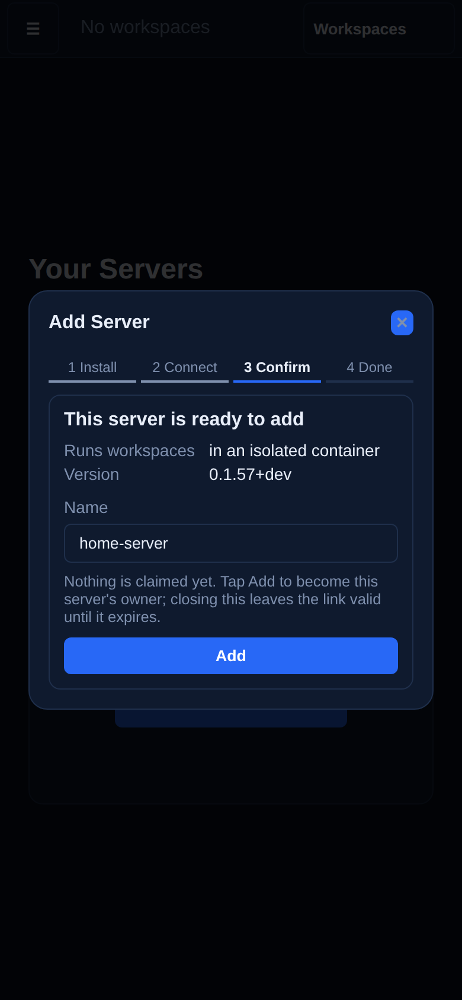

# Chapter 2: Connect your phone

In 2 minutes your phone lists your server as connected.

The server is running, but your phone has never heard of it. Open the camera on your phone and point it at the QR code from chapter 1. If you cannot scan it, copy the link instead and paste it into **Add Server** in the app. Nothing is claimed yet: the app first says what you are adding and checks that your phone can reach it. You confirm, and the server shows up in your list.

<!-- media:add-server-phone -->

Watch, 59 s

*A rendered walkthrough on scripted data, not a recording of a real device.*
<!-- /media -->

<!-- course-steps:add-server -->
1. Open the app and add a server. Tap **Add Server**.
2. Step 1 installs the server; it announces itself while you run the command. Tap **Next**.
3. Paste the link the installer printed.
4. Nothing is claimed yet: this says what you are adding.
5. Then it checks that this device can reach the server.
<!-- /course-steps -->

The first person to connect becomes the owner, and nobody else can.

## If it doesn't work

- **The QR opens a search, or another app.** That app is not Termenbox. Open the Termenbox app first, tap **Add Server**, and paste the link the installer printed instead.
- **The app says "Server unreachable".** Your phone's network may block UDP, as some mobile and office networks do. Join the same Wi-Fi as the server, or see [How it connects](../guide/networking.md) for the other paths.

## You can now

- See your server in the list, marked as connected.

Next: [Chapter 3, First workspace](03-first-workspace.md).
