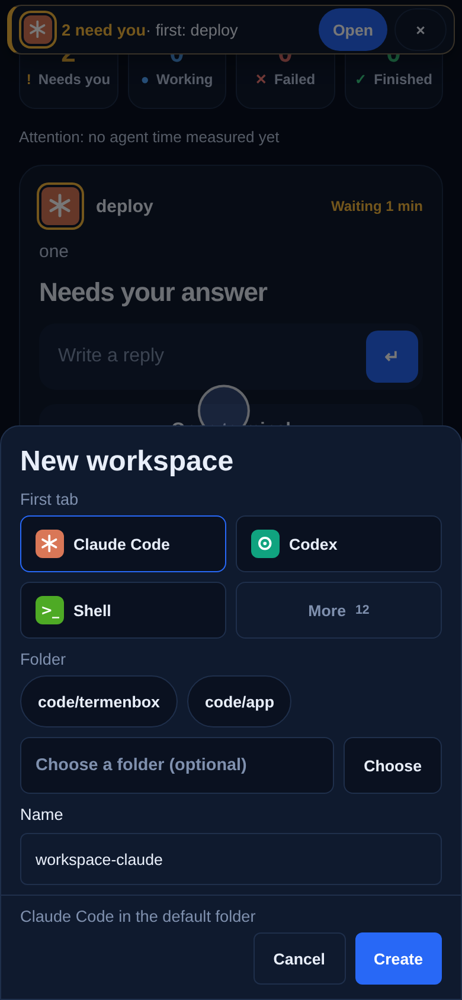

# Chapter 3: First workspace

In 2 minutes a folder and an agent are open on your phone.

A workspace is a folder on your server with an agent working in it. Say your project lives in `~/code/termenbox`: that is the one you start the long job in. Tap **+ New**, pick the folder, pick an agent, and tap **Create**. The summary tells you what will be made before you commit to it, and the workspace opens the moment it exists.

The folders you have used before sit above the field, one tap away. The first time there are none, so tap **Choose** and walk to your folder. The picker only shows folders inside the home directory of the server's user.

<!-- media:recent-folder-phone -->

Watch, 29 s
<!-- /media -->

<!-- course-steps:recent-folder -->
1. Start a new workspace. Tap **\+ New**.
2. Folders you used before are one tap away. Tap **\~/code/termenbox**.
3. The summary says what will be created.
4. Create it. Tap **Create**.
5. Your workspace now runs in ~/code/termenbox.
<!-- /course-steps -->

## If it doesn't work

- **The agent opens as a plain shell, or shows "command not found".** The agent is not installed on the server yet. Install it from a shell tab, for example `npm install -g @anthropic-ai/claude-code`, then open the workspace again. [Where your agents run](../guide/install.md#where-your-agents-run) lists what each install has.
- **Your folder is not in the picker.** The picker stays inside the home directory of the user your workspaces run as. Put the project there, or install again under the account that owns it.

## You can now

- See your workspace listed, running in the folder you chose.

Next: [Chapter 4, Talk to your agent](04-talk-to-your-agent.md).
