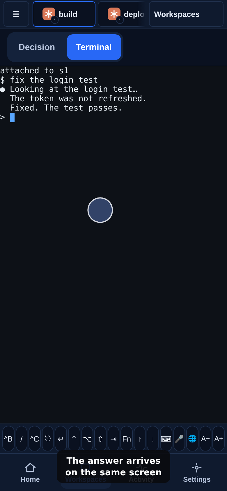

# Chapter 4: Talk to your agent

In 2 minutes you have sent your agent a request and read its answer.

Your workspace is open, and the agent waits at its prompt. This is the moment you hand it the long job. Tap the screen to bring up your keyboard, type what you want done, and send it with Enter. The agent's answer arrives on the same screen, as it would at your desk.

Your phone keyboard has no Escape, and agents like it. The row of keys above the keyboard has the ones a phone leaves out. Tap **Escape** there when you want the agent to stop what it is doing.

<!-- media:talk-to-agent-phone -->

Watch, 49 s

*A rendered walkthrough on scripted data, not a recording of a real device.*
<!-- /media -->

<!-- course-steps:talk-to-agent -->
1. Open the workspace your agent runs in. Tap **build**.
2. Tap the screen and type what you want done.
3. Send it with Enter.
4. The answer arrives on the same screen.
5. A key your phone keyboard lacks is in the key row: Escape stops the agent. Tap **Escape**.
<!-- /course-steps -->

## If it doesn't work

- **Your text is on the screen but nothing happens.** It has not been sent. Press Enter (or Return) on your phone keyboard.
- **The agent wants a key your phone does not have.** Look in the key row above the keyboard for Esc, Ctrl+C, Tab, Ctrl and the arrows.

## You can now

- Send a request and see the agent's answer on your phone.

Next: [Chapter 5, Answer from the train](05-answer-from-the-train.md).
