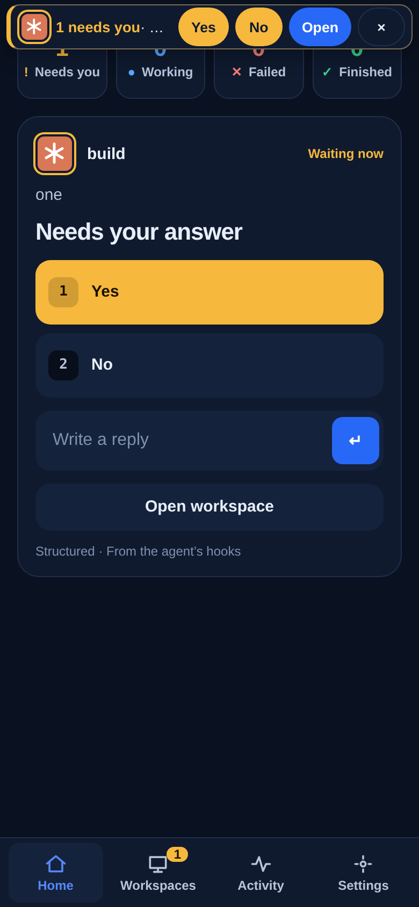

# Chapter 5: Answer from the train

In 3 minutes you know how a waiting agent reaches you, and you can answer it with one tap.

You have left your desk. The agent keeps working, and sooner or later it needs a decision from you. When it does, the app shows a banner that names the workspace and offers the agent's choices. Tap your answer. It goes to the tab that asked, and that tab goes back to **Working**.

To be told while the app is closed, turn on notifications once, in Settings. A notification only says that a workspace needs you; it never carries what the agent wrote. Tapping it opens the same choices.

<!-- media:answer-from-the-train-phone -->

Watch, 30 s

*A rendered walkthrough on scripted data, not a recording of a real device.*
<!-- /media -->

<!-- course-steps:answer-from-the-train -->
1. You left your desk; your agent keeps working.
2. When it needs you, a banner names the workspace and offers its choices.
3. Tap your answer; it goes to the tab that asked. Tap **Yes**.
4. The agent takes it and goes back to Working.
<!-- /course-steps -->

## If it doesn't work

- **No notification arrives.** The phone has not allowed them, or the server has no push key yet. Allow notifications for Termenbox in your phone's settings, and run `termenbox-server --setup-push` on the server once. [Notifications](../guide/workspaces.md#notifications) has the rest.
- **On an iPhone the switch for notifications is missing.** The app has to be on your Home Screen first, and your iPhone needs iOS 16.4 or newer. Use Share, then Add to Home Screen, and open it from there.

## You can now

- See which tab asked, answer with one tap, and watch it return to Working.

Next: [Chapter 6, Come back later](06-come-back-later.md).
