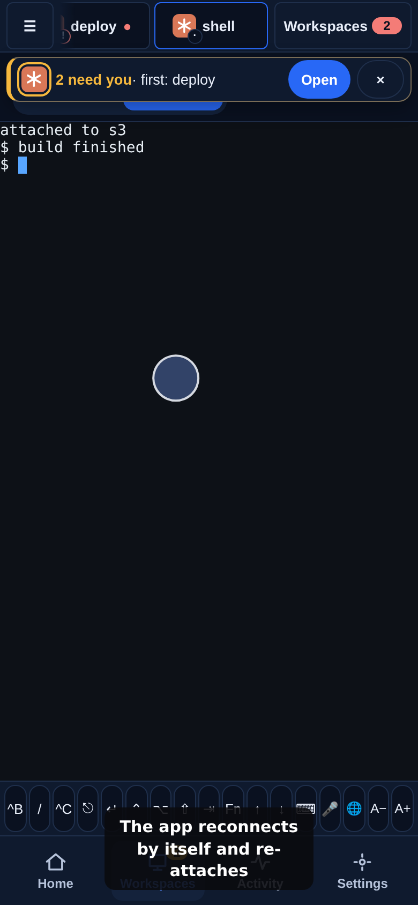

# Chapter 6: Come back later

In 2 minutes you have closed the app, opened it again and found your work where you left it.

Close the app. Lock the phone. Drive through a tunnel. None of it stops your agent, because the work lives in tmux on your server and your phone is only a window onto it. When the app returns it reconnects by itself and re-attaches, and the screen repaints exactly as it was.

So you never need a "resume" button. Open the same workspace and carry on.

<!-- media:resume-after-close-phone -->

Watch, 27 s

*A rendered walkthrough on scripted data, not a recording of a real device.*
<!-- /media -->

<!-- course-steps:resume-after-close -->
1. Open a workspace. Tap **shell**.
2. Its screen is live on the server.
3. Lose the signal: a tunnel, a lock screen, a dropped Wi-Fi.
4. The app reconnects by itself and re-attaches.
<!-- /course-steps -->

## If it doesn't work

- **The workspace is marked dormant.** The tmux server on the machine was stopped, for example by a restart. Opening the workspace recreates its tabs as shells with the same names and order, but the work that was running in them is gone. [Workspaces and tabs](../guide/workspaces.md#workspaces-and-tabs) explains restore.
- **The app cannot reach the server.** The server may be off, or your network blocks UDP. Check that the server is running, then see [How it connects](../guide/networking.md).

## You can now

- Leave the app, come back, and find the same screen.

That is the course. The Master part, on the terminal, search, several servers and fixing a connection, follows.

Next: [The Master part, in the course index](README.md).
